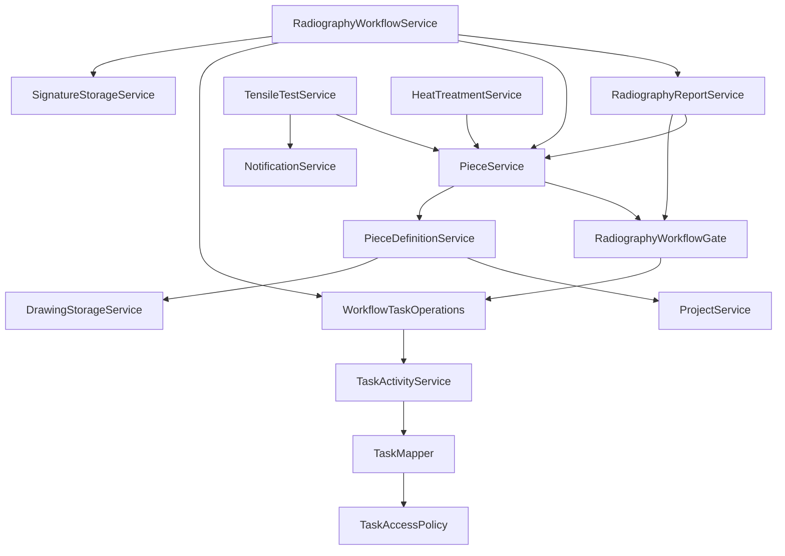

# Backend architecture

Update 2026-11-01: category 1 introduces MANAGER (full access), explicit-grant ADMIN/OPERATOR, manager-only account management and access audit. Historical ADMIN-as-full-access descriptions below are superseded by [User access](USER_ACCESS.md). V38 and the sanitized fixture include the new audit table; runtime upgrade requires explicit initial-manager selection. Local Java/MySQL validation is blocked by missing Maven dependencies; see the linked implementation/upgrade notes.

Update 2026-10-31: ScrapService records cycles through PieceService’s central stage boundary, including bulk/admin/trusted/tensile routes. ScrapController provides history, versioned reason editing and the VIEW_DASHBOARD scrap report. V37 is additive; existing workflow/archival guards remain. See [scrap](SCRAP.md).

GitHub preparation note: the earlier inline-key description below is historical. Current application.properties uses external datasource/JWT placeholders and the bootstrap password is explicit; see [Cloud testing](CLOUD_TESTING.md). This source-publication task changes documentation/Git metadata only and preserves runtime code and contracts.

Update 2026-10-30 (security fixes and requested key-storage rollback): access tokens use immutable user UUIDs and an opaque HMAC credential stamp captured by the password provider. At the user's request, a new random signing key is stored directly as app.jwt.secret in application.properties and included in the JAR; JWT_SECRET is no longer required. This reverts audit #2's external-key remediation only. Legacy username tokens are rejected. Password changes/reset invalidate existing tokens without a schema change. Credential writes lock the user row; User uses DynamicUpdate so stale profile/signature writes cannot restore an old password. DataSeeder no longer grants permissions to existing operators. Piece description changes require MANAGE_PIECES at both HTTP and service boundaries. See [implementation and launch notes](../audits/2026-10-30-security-fixes-fa.md).

Update 2026-10-30 (schema compatibility): TaskTypeSchemaRepair runs at startup on MySQL to reconcile legacy tasks.task_type ENUMs and pure enum CHECKs missing current task codes; V36 supplies a manual counterpart. It preserves current and mixed/business checks, rows, task ownership and permission seeding. New melt entry task creation otherwise produces an integrity error translated by the existing handler to generic 409. See [melt passports](MELT_PASSPORTS.md) for the synthetic reproduction and deployment limits.

Update 2026-10-30: MeltPassportService handles versioned ADMIN assignment and actor-specific editing; MeltWorkflowTasks uses WorkflowTaskOperations within the passport transaction. TaskAccessPolicy/TaskSpecifications add live shared melt-review visibility to list, inbox, detail and nested resources. Shared review tasks are excluded from individual stats/reminders and unauthorized submitter notifications. The existing PieceService/StageTransitionPolicy approval movement is preserved. See [melt passports](MELT_PASSPORTS.md).

Update 2026-10-29 (text positions/order): DefectPosition and the three legacy RadiographyDefect position mirrors now use String/VARCHAR(255); related request, response and welding-detail DTOs use text under the existing keys. RadiographyDefectService trims text, defaults blank end to start, caps endpoint length, and deduplicates endpoint pairs without imposing numerical/lexical order. Report first-position mirrors and standalone locations remain synchronized. RadiographyDefectMapper swaps reshoot/welding display tokens when both flags are true; mutations, permissions and production/workflow routing are unchanged. The existing LegacyDefectChainRepair SQL works with widened text columns and was exercised with numeric and text fixtures on isolated MySQL. See V34 and development validation notes.

Update 2026-10-29: RadiographyDefectService validates new first/second defect types through the shared DefectTypes catalog, including required OTHER custom text. RadiographyDefectRequest/Response and the common mapper carry reshootOk for report chains. The transactional service rejects simultaneous secondDefect/reshootOk, removes obsolete children when switching to reshoot, and leaves course results, piece movement and workflow decisions unchanged. updateDefect locks the root via RadiographyDefectRepository.findForUpdateById to serialize competing chain edits; this does not establish concurrency safety for unrelated delete/confirm/workflow paths. Workflow snapshots automatically include the new DTO field; old snapshots/rows read absent/null values as false. See V33/database notes.

Update 2026-10-24: PerformanceController/PerformanceService provide separate `/api/users/{userId}/performance/periods` contracts. PerformanceAccessPolicy allows owner/ADMIN reads and ADMIN writes, independent of MANAGE_TASKS. Three new persistence tables retain criteria, periods and copied-identity audit snapshots. User-first/period-second locking, current criterion reads, aggregate versioning and a nullable unique open-user key protect edits/rollover. User deletion now locks and rejects evaluation history. See [employee performance](EMPLOYEE_PERFORMANCE.md).

Update 2026-10-24: `PATCH /api/pieces/{id}/welding-dispatches/{dispatchId}` uses `UpdateWeldingDispatchRequest` and transactional `PieceService.updateWeldingDispatch`. The existing `MOVE_PIECE_STAGE` permission checker governs access, including the admin override. The service checks active piece/station state, workflow exclusion, nested dispatch ownership and same-piece open defects. A piece write lock and an open-dispatch write lock serialize editing with dispatch closure; the existing completion/closure lookups also lock the dispatch row. This does not establish complete concurrency safety for every production route. Dashboard stage occupancy adds nullable `subStageKind`/`subStage` to rows and batch-fetches substage histories/process dates; no schema changes are required. READY is excluded from both stuck-alert endpoints and overview totals.

Update 2026-10-22: general melt list/consumption methods require `VIEW_DASHBOARD` or ADMIN; pending filters additionally require melt approval authority. Piece-specific access/review stays independent. Candidate lookup parses numeric/full references before querying, eliminating SQL CAST/CONCAT and the reproduced MySQL mixed-collation error. No schema change or permission seed was added. See [melt passports](MELT_PASSPORTS.md).

Update 2026-10-19: [melt passports](MELT_PASSPORTS.md) add `MeltPassportController`/transactional `MeltPassportService`, material/member/check/event persistence, reviewer authorization, locking and a central CASTING departure gate. `Piece` and `MeltPassport` now have optimistic versions; older statements about entities lacking versions apply to the other existing entities.

Reviewed: 2026-10-16. Package root: `com.factory.productmanager`. Statements describe source behavior; production deployment was not inspected.

## Layers and boundaries

- `ProductManagerApplication` starts the single Spring Boot application.
- Controllers bind UUIDs, enums, query parameters, multipart uploads, and validated DTOs. Most operations return `ResponseEntity`; tasks and radiography workflow endpoints also return records directly.
- Services perform business checks, DTO assembly, JPA operations, audit recording, and notifications. Most write services have class-level `@Transactional`, with selected reads marked `readOnly=true`.
- Repositories use `JpaRepository`, derived methods, JPQL, entity graphs, and projections. `PieceRepositoryCustom`/`PieceRepositoryImpl` implements Criteria-based tracking ID pagination/counts. `TaskSpecifications` handles permission-aware task filtering and ordering.
- Entities use Jakarta Persistence, UUID keys, string enums, and mostly lazy associations. Request/response DTOs are mostly mutable Lombok classes; newer task/workflow contracts also use records. Mapping is manual, with shared `TaskMapper` and `RadiographyDefectMapper`.
- There is no enforced module boundary: modules are package conventions inside a common service/repository/model hierarchy.

## Controller/service map

Paths below are API families, not an exhaustive OpenAPI contract. Read the corresponding controller before changing an endpoint.

| Controller(s) | API family | Primary service(s) |
|---|---|---|
| `AuthController` | `/api/auth/login`, `/api/auth/me` | `AuthService`, `JwtService` |
| `ProjectController` | `/api/projects` | `ProjectService`, piece archival operations |
| `PieceDefinitionController` | `/api/piece-definitions`, drawings | `PieceDefinitionService`, `PieceService` |
| `PieceController` | `/api/pieces`, tracking/summary, stage/substage/date/history, welding station | `PieceService` |
| `RadiographyDefectController` | `/api/pieces/{pieceId}/radiography-defects`, `/api/radiography-defects` | `RadiographyDefectService` |
| `RadiographyReportController` | definition templates, piece reports, template/report IDs | `RadiographyReportService` |
| `RadiographyWorkflowController` | `/api/radiography/queue`, interpreters, piece workflow, workflow decisions/documents | `RadiographyWorkflowService` |
| `HeatTreatmentController` | piece heat treatments, `/api/heat-treatments`, `/api/heat-treatment-batches` | `HeatTreatmentService` |
| `TensileTestController` | piece tests, `/api/tensile-tests`, disposition/pending review/sample labels | `TensileTestService` |
| `WeldingMapMarkController`, `PieceNoteController` | piece/definition welding marks, piece notes | `WeldingMapMarkService`, `PieceNoteService` |
| `DashboardController` | `/api/dashboard`: stats, overview, alerts, defect/occupancy/welding/quality/trend reports | `DashboardService`, `TensileTrendService` |
| `TaskController`, `TaskCollaborationController` | `/api/tasks`, assignee/part lookups, comments/checklist/activities | Task services listed below |
| `NotificationController` | `/api/notifications`, unread/read/read-all/dismiss | `NotificationService` |
| `UserController`, `PermissionController` | `/api/users`, password/permissions, `/api/permissions` | `UserService`, `PermissionService` |
| `UserProfileController`, `UserSignatureController` | user profile/tasks, `/api/profile/signature` | Profile, task-query/statistics and signature services |

## Module dependencies

The gate avoids depending on `RadiographyWorkflowService`, preventing a direct service dependency cycle. Its comment says it only depends on repositories, but it now also uses workflow task operations and an event recorder: trust the fields and calls over that comment.

Tasks have a more decomposed structure: `TaskService` handles writes, `TaskQueryService` queries, `TaskLookup` resource visibility, `TaskAccessPolicy` authorization, `TaskDetailAssembler`/`TaskMapper` responses, and separate comment/checklist/activity/statistics/notification/reminder services. `WorkflowTaskOperations` is an internal route for workflow-controlled task changes. General task APIs block workflow task status, reassignment, cancellation, and linked-resource changes where those would bypass the radiography workflow.

Dashboard calculations depend directly on several repositories rather than on domain services. `TensileTrendService` uses a flat sample projection and the Spring-independent `service/trend/TrendAnalyzer`.

Production tracking now adds read-only `TensileTrackingService` enrichment to the paginated list. `TensileTestRepository.findTrackingContext` fetches flat test/disposition projections for tensile-stage pieces; one batch history query checks the return path. `PieceResponse.tensileTrackingInfo` is nullable display context, not a substage. It includes the newest relevant decision and recorded aging durations for the current cycle. No test, disposition, stage or schema mutation is performed by this path.

`PieceSearchTerm` distinguishes numeric-only queries (exact integer piece number, accepting localized digits/leading zeros) from partial text queries. The tracking list, count and summary share the same Criteria predicate; the legacy `/pieces/search` service uses the same parsing rule. Dedicated name/project filters remain partial text searches. Stage/substage history responses include the existing location-level `processDate` while preserving their original repository order by recorded `changedAt`; execution dates do not reorder history rows.

## Authentication and authorization

Evidence: [SecurityConfig](../../src/main/java/com/factory/productmanager/security/SecurityConfig.java), [JwtAuthenticationFilter](../../src/main/java/com/factory/productmanager/security/JwtAuthenticationFilter.java), [PermissionService](../../src/main/java/com/factory/productmanager/service/PermissionService.java), [Permission enum](../../src/main/java/com/factory/productmanager/model/entity/Permission.java).

- Login authenticates with a BCrypt-backed DAO provider and issues an access-v2 JJWT token containing immutable user UUID subject, role claim, issue time, expiry and an opaque HMAC credential stamp. The signing key is stored as app.jwt.secret in application.properties at the user's request; it is packaged in the JAR. Missing/weak configuration is still rejected. Preserve the key between builds; replacing it invalidates existing tokens.
- Each Bearer request verifies the signature/expiry/format, reloads the user by UUID and checks enabled state and the current credential stamp. Current database permissions/role govern authorization rather than trusting the token role claim alone. The stamp binds the stored BCrypt hash and UUID with a domain-separated HMAC; neither password nor hash is in the token.
- HTTP sessions are stateless; CSRF is disabled. `/api/auth/login` is public; the rest of `/api/**` requires authentication. Static content is public and the final security fallback permits other paths. CORS permits any origin pattern on API routes.
- Roles are only `ADMIN` and `OPERATOR`. Interpreter, radiography reviewer, tensile reviewer, and task manager are permission-based responsibilities, not additional roles. Administrators implicitly receive every permission.
- `PermissionChecker` calls `PermissionService` for method-security expressions. Several reads require authentication only, including project/piece/inspection reads; there is no general per-project membership/tenant policy.
- Task visibility is administrator, assigned user, or creator who still has `MANAGE_TASKS`. Unauthorized/nonexistent task IDs both return 404. Visible but disallowed operations return 403. Profiles are visible to self or task managers/admins; returned tasks still use task visibility.
- Radiography workflow visibility is a reviewer or that workflow's interpreter. The document endpoint has an explicit exception: a `MANAGER_FINAL` version is accessible to any authenticated user; earlier versions require workflow visibility. Approval by the interpreter requires the assigned user's identity. Manager decisions accept an authorized reviewer; they are not restricted to the manager-task assignee. No separate-person rule prohibits one eligible user from filling both approval responsibilities.
- Password changes/reset replace the salted BCrypt hash and invalidate all previously issued access tokens, including when resetting to the same plaintext password. Issuance uses the provider's actually authenticated credential snapshot so a concurrent reset cannot accidentally mint a token bound to the new password. Reusing a deleted username cannot revive a token because its UUID is different. Credential changes lock the user row; User DynamicUpdate prevents an unrelated stale entity write from restoring the old hash. Logout alone remains client-side removal; no new refresh or logout-all endpoint was added. The password-change UI clears its session immediately and asks for a fresh login.

| Permission group | Codes |
|---|---|
| Dashboard/catalog | `VIEW_DASHBOARD`, `MANAGE_PROJECTS`, `MANAGE_PIECE_DEFINITIONS`, `MANAGE_PIECES` |
| Movement | `MOVE_PIECE_STAGE`, `UPDATE_RADIOGRAPHY_SUBSTAGE`, `UPDATE_HEAT_TREATMENT_SUBSTAGE`, `UPDATE_ROUGH_MACHINING_SUBSTAGE` |
| Inspection/support | `MANAGE_RADIOGRAPHY_DEFECTS`, `MANAGE_PIECE_NOTES`, `MANAGE_WELDING_MAP` |
| Tensile | `MANAGE_PIECE_ASSIGNMENT` (legacy code meaning test entry), `REVIEW_TENSILE_TEST` |
| Heat log | `MANAGE_HEAT_TREATMENT_LOG` |
| Tasks | `MANAGE_TASKS`, `RECEIVE_TASKS` |
| Radiography approvals | `INTERPRET_RADIOGRAPHY`, `REVIEW_RADIOGRAPHY_REPORT` |

Report editing additionally requires `MANAGE_RADIOGRAPHY_DEFECTS` at its controller. Giving a user only `INTERPRET_RADIOGRAPHY` makes them assignable but does not by itself grant access to the legacy report-write endpoint. This permission combination needs explicit validation when provisioning interpreters.

## Transactions, errors, and side effects

- Ordinary Spring transaction propagation joins nested service calls. Radiography decisions update reports, approvals, versions, piece state, tasks, activities, events and database notifications in one transaction. Workflow updates use a repository `PESSIMISTIC_WRITE` lock; initial assignment relies on unique `open_key` plus flush.
- Ordinary piece/task/tensile writes do not have comparable locks, and no entity has `@Version`. Transactional atomicity does not prevent stale simultaneous updates.
- `RadiographyReportService.getReportsByPiece` is a read-named method that adds missing template lines and flushes within a write transaction. Nested calls from a read-only workflow query need special care.
- Task activity/workflow timestamps use `Clock` and `OperationClock` for ordering. Older services/entity lifecycle methods use direct `LocalDateTime.now()`. The configured clock uses the JVM's default zone.
- `TaskReminderService.scheduledRun()` calls its own `@Transactional sendReminders()` method. **Risk:** same-instance invocation bypasses the transaction proxy; direct test calls through the Spring bean do not prove scheduled execution has the same transaction boundary.
- Reminder deduplication is an existence check plus a nonunique index; it is not guaranteed by a unique database constraint despite the service comment. Multiple schedulers can race.
- Notifications are database records, polled by the browser. No email/SMS/external messaging is evidenced. Tensile notification backfill runs at application-ready time, once per process, with explicit per-test `TransactionTemplate` transactions and logged failures.
- Drawings/signatures are local filesystem side effects outside database atomicity. Approval-signature copies register rollback cleanup. Profile signature replacement/deletion and drawing operations do not have equivalent commit coordination; drawing replacement deletes the previous file before validating/storing the new one.
- `GlobalExceptionHandler` returns `ApiError(timestamp,status,message,errors?)`: 400 for validation/body/type/business argument/state errors, 401 for bad credentials, 403 for denial, 404 for missing resources, 409 for explicit duplicate exceptions, and generic logged 500 for unexpected exceptions. Security-filter 401/403 uses the same error DTO.
- Database integrity and locking exceptions have no dedicated conflict mapping. A race that bypasses pre-checks can become generic 500. Some compatibility repairs catch/log failures and let startup continue; others can fail startup.

## Risk register

These are source-confirmed observations with inferred consequences; they were not exercised against production.

| Priority | Observation and source anchor | Consequence / next validation |
|---|---|---|
| High | `application.properties` has Hibernate update plus Flyway properties; POM/classpath lacks Boot Flyway integration; startup repair classes also mutate schema/data | Verify actual startup beans and schema history on a disposable MySQL clone before any migration/configuration change; see database document |
| High | `RadiographyDefectService` has no workflow gate; create/update only check archival, delete/confirm lack even that check | A holder of defect permission can alter defects during manager review; add focused characterization tests before a fix |
| High | `RadiographyWorkflowGate.assertReportEditable` reads without the decision lock; completed workflows clear `open_key` | Report writes can race with issue/approval. Completed live reports remain editable/deletable after closure; signed snapshots persist separately |
| Fixed 2026-10-30 | DataSeeder no longer migrates/grants permissions on existing users, including empty sets; the existing marked one-time RECEIVE_TASKS migration remains separate | Empty, revoked and explicit permissions are covered by restart regressions; admins provision legacy access explicitly |
| High | `DataSeeder` contains fixed bootstrap credentials and logs them; default properties contain sensitive database/JWT settings | Review deployment secret injection/bootstrap policy and rotate if exposed, without copying values into issues/docs |
| High | `TensileTestService.updateTest`, `saveDisposition`, `deleteTest` preserve or independently mutate different parts of state | A result can contradict an earlier approval; later disposition edits can move a piece already further downstream; deleting an auto-approved test does not reverse movement |
| Medium | No `@Version`; max+1 tensile indices/report versions, batch find-or-create, open dispatch pre-checks | Lost updates or duplicate-key errors under concurrency; some unique constraints limit duplicates but not workflow correctness |
| Medium | Project/definition hard deletes combine cascades and cross-module references; `PieceService.deletePiece` instead archives | Audit/task/heat/report references may block deletion or cascade away; test populated relationships and define retention policy |
| Medium | File side effects and scheduled invocation/deduplication above | Broken file references or duplicate reminders, especially after rollback/multiple-instance deployment |
| Medium | `PieceService`, `DashboardService`, `RadiographyWorkflowService` have broad responsibilities | Changes to movement, dates, DTOs and reports have a large regression surface |
| Medium | Dashboard/report methods load whole project/all-active collections; several catalog methods return unpaged lists | Growing memory/query cost; measure realistic data volumes before refactoring |
| Medium | Current state, change history and user-entered dates are distinct; date snapshots are upserts per stage/substage | Repeated visits are not individually represented by process-date rows; report totals and time filters can differ by design |
| Medium | Broad authenticated reads/CORS and localStorage JWT remain; password-bound invalidation is implemented | Confirm intended access/trust boundary; ordinary logout is still client-side, and no general refresh/logout-all feature was introduced |

## Duplication and regression boundaries

1. `StageTransitionPolicy.userMoves` and `forwardMove` both encode the normal graph. Piece single/bulk, generic stage/substage, dated advance, welding return, and trusted tensile moves add further paths. Keep their behavior consistent, but first characterize intentional differences such as process-date requirements and bulk skipping.
2. Default substage resolution appears in policy/service/report/repository/UI code. Legacy radiography alias conversion also exists in enum/converter/formatter, SQL and startup repairs. Unknown stored aliases currently default to `SHOT`; do not assume invalid input always fails.
3. Role/permission checks exist in `PermissionService`, `TaskAccessPolicy`, workflow predicates, controller expressions, and browser helpers. They differ in resource scope; unifying them without tests can broaden access.
4. Display-name resolution and DTO assembly repeat across services; historical display-name strings are not always user foreign keys.
5. `WorkflowTaskOperations` and `TaskService` each handle task state/activity updates for different callers. General task endpoints must not complete approval tasks directly.
6. Heat-treatment routing appears in production policy, tensile aging/re-operation decisions, and welding returns. Logging a furnace operation is a separate concern and currently does not advance the stage.

Preserve existing architecture until focused tests and an authorized implementation task establish the desired change. No fixes were applied during this review.
