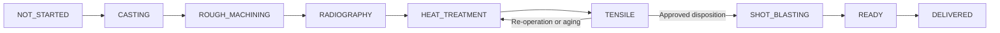
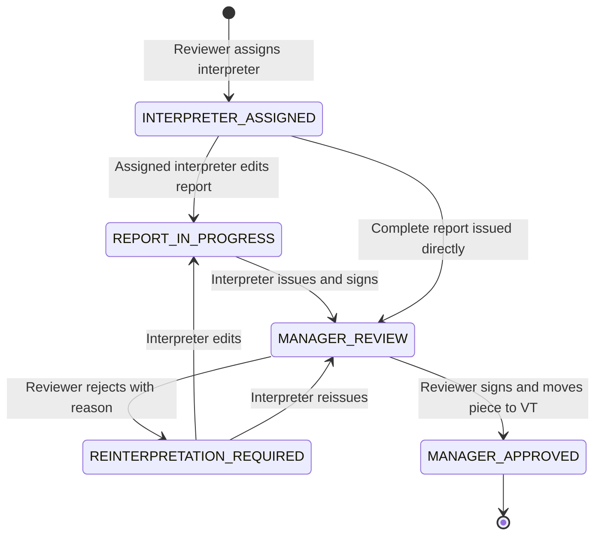

# Business workflows

Update 2026-11-01 (items 2–1/2–2 only): normal progression uses independent ADVANCE_PIECE_STAGE; forward skips require MANAGER or an explicitly permitted ADMIN, a reason and an atomic audit. Other category-2 permission splits are deferred. See [Stage movement access](STAGE_MOVEMENT_ACCESS.md) for legacy-route guards, upgrade grants, V39 and validation limits.

Update 2026-11-01: category 1 introduces MANAGER (full access), explicit-grant ADMIN/OPERATOR, manager-only account management and access audit. Historical ADMIN-as-full-access descriptions below are superseded by [User access](USER_ACCESS.md). V38 and the sanitized fixture include the new audit table; runtime upgrade requires explicit initial-manager selection. Local Java/MySQL validation is blocked by missing Maven dependencies; see the linked implementation/upgrade notes.

Update 2026-10-31: Every new transition to SCRAPPED requires a welding-catalog reason (OTHER requires text), with optional notes. Reasons are editable without changing the original scrap time, and return/re-scrap preserves independent cycles. The dashboard scrap report includes archived and legacy current scraps. See [scrap](SCRAP.md).

Update 2026-10-30: [melt passports](MELT_PASSPORTS.md) have ADMIN assignment/reassignment and task entry/review rounds. Only the assigned operator/ADMIN edits; live melt approvers share the review inbox without dashboard access. Return reopens the same entry task; approval atomically completes review and moves all passport members, including eligible pieces added by the operator. Central movement/date/archive rules are unchanged.

Update 2026-10-29 (text positions/order): positions use trimmed text endpoints (up to 255 characters each), preserving point/range notation and insertion order: (L4), (L5-L8), (12-20). End omitted/blank means a point; duplicate endpoint pairs are rejected. Numeric/lexical endpoint ordering is no longer imposed on arbitrary labels. Legacy startCm/endCm/locationCm keys remain but return strings; numeric JSON inputs and numeric snapshot values remain readable. Both report and standalone defect entry support text locations, with first-position mirrors preserved for welding. When welded and reshootOk are true, the displayed chain is defect → ریشوت → جوش → OK; if action 1 exists it stays between the swapped reshoot/welding tokens. Other chains retain their existing order. Preview, report chips, print and newly generated workflow snapshots use the same ordering; stored approval/signature snapshot bytes are not rewritten.

Update 2026-10-29: the standard defect catalog is F.M.M, F.M.L, F.M, S.P, S.C, CR, G.H, G.P, VT, C.S, M.R, ماسه ریزی, ابعادی, plus OTHER with required custom text. Radiography first/second defect entry, piece defects, welding dispatches/maps and dashboard filters use this catalog. The report form now uses the shared selector and explicit OTHER field instead of its separate free-text suggestion list. Obsolete codes are removed from new-entry choices; existing records/snapshots are not deleted. THICKNESS_MEASUREMENT keeps its stored code and is displayed as «ضخامت مجاز».

Report-chain follow-up is optional: either secondDefect, or reshootOk=true (rendered «ریشوت → OK»), or neither. The service rejects both outcomes together and rejects report-only outcomes on standalone piece defects. Switching to reshoot removes the previous child; switching to a second defect clears reshoot; removing follow-up clears both. This result describes only the original defect chain; it does not set the course result, approve a workflow, confirm station welding, or move the piece. Report/piece DTOs, preview, print and workflow snapshots include it. Existing workflow authorization/approval paths and their documented gaps below are unchanged.

Update 2026-10-26: approved melt passports have a separate ADMIN-only correction operation, available after downstream movement, archival or another casting cycle. It preserves approval identity/time, membership, active keys, piece state, history and actual process dates; changing the melt date changes only the passport. Validated business corrections record actor/time, optional reason and before/after values. No-op saves create no event. Changed magnesium inputs require explicit atomic calculation (or clearing all six). Ordinary pending/approved edit and calculation endpoints remain locked. See [melt passports](MELT_PASSPORTS.md).

Update 2026-10-24: [employee performance evaluation](EMPLOYEE_PERFORMANCE.md) is separate from task assignment/completion. Administrators define per-person weighted criteria at full initial score, enter scores with reasons, manually close/copy periods, and correct closed periods with audit retention. Only the employee and administrators can read results; MANAGE_TASKS does not grant evaluation visibility. Evaluation history prevents hard deletion of the employee account.

Update 2026-10-24: an authorized welding operator can edit the current open dispatch's defect type/custom description, notes and linked defects while the unarchived piece remains in WELDING and outside an open radiography workflow. Newly linked defects must be open and belong to that piece; previously linked defects may be retained even if confirmed during welding. Completed dispatches remain historical. Editing preserves dispatch sender/time, origin, production history, process dates and piece position. Completion confirms only the currently linked defects and retains the original return routing. Stage occupancy now includes main-stage rows plus rows for all three substage kinds, normalizes legacy radiography aliases, and uses the stored process date (or current process date/history fallback). As with main stages, it reports the latest presence per location, not each repeated visit; historical unknown exits are shown as unknown. Stuck-piece alerts omit READY pieces, including their totals. Other WIP/count rules are unchanged.

Reviewed: 2026-10-16. These are implemented code paths, not assumptions about factory practice. Business intent is unverified where called out. Related API authorization is described in [backend architecture](BACKEND_ARCHITECTURE.md).

## Project, definition, and individual piece

`ProjectService` maintains project code/name; code is unique. `PieceDefinitionService` maintains rows within a project, names, a shared drawing and optional minimum UTS/YS/EL/HB. A definition's row number is unique within its project. Each `Piece` represents one numbered physical instance and begins at `NOT_STARTED`; numbers are unique within a definition, including archived pieces.

Single and consecutive bulk creation exist. Bulk creation rejects conflicting numbers rather than partially inserting a requested range. Pieces can be resolved by a human-readable project/row/piece reference; the implementation parses and validates that reference in `PieceService.findByRef`.

Deleting a piece archives it with actor/time; restore retains its history. Bulk/project/definition archival operations also exist. Project and definition deletion remain hard deletes. Do not assume their behavior matches piece archival.

## Production movement

Update 2026-10-19: every departure from CASTING now requires an approved active melt passport, including admin/trusted/bulk and welding paths. Passport approval atomically advances all linked members through the existing policy. See [melt passport workflow](MELT_PASSPORTS.md). Prior casting cycles keep their passport memberships.

Authority: [StageTransitionPolicy](../../src/main/java/com/factory/productmanager/service/StageTransitionPolicy.java), [PieceService](../../src/main/java/com/factory/productmanager/service/PieceService.java), stage/substage enums.

Normal forward route:

| Main stage | Normal substage route / exit |
|---|---|
| `NOT_STARTED` | `CASTING` |
| `CASTING` | Rough machining, default `DEBURRING` |
| `ROUGH_MACHINING` | `DEBURRING -> INITIAL_CORRECTION -> MACHINING -> RADIOGRAPHY/SHOT` |
| `RADIOGRAPHY` | `SHOT -> INTERPRETATION -> VT -> HEAT_TREATMENT/AWAITING_OPERATIONS` |
| `HEAT_TREATMENT` | `AWAITING_OPERATIONS -> STAGE_1 -> STAGE_2 -> CNC_SAMPLE -> TENSILE` |
| Heat `STAGE_3`, `STAGE_4`, `STAGE_5` | Aging return locations; each can exit to `TENSILE` |
| `TENSILE` | No ordinary forward move; disposition routes the piece |
| `SHOT_BLASTING`, `READY` | `READY`, then `DELIVERED` |
| `DELIVERED`, `WELDING` | No ordinary forward move; normal policy still permits scrapping |
| `SCRAPPED` | Terminal for normal movement |

Normal policy adds `SCRAPPED` as a permitted target from every non-scrapped stage. Administrators have correction destinations beyond the normal graph, except direct transfer to `WELDING`; they still cannot manually move a piece with an open radiography workflow. Trusted internal tensile/welding routing bypasses the normal graph while retaining central stage-change side effects and workflow guards.

`advancePiece` is a dated, single-forward-step action. Except from `NOT_STARTED`, it requires a current process date or one supplied in the request, snapshots outgoing stage/substage dates, records movement, and clears the current date for the next location. It verifies the specific permission of the resulting move.

Generic stage/substage PATCH and bulk APIs are separate paths and do not impose all of `advancePiece`'s date rules. Generic substage setters record history without the dated advance snapshot/reset sequence. Bulk stage movement skips pieces already at the destination and some welding cases; eligible mutations share a transaction, but a successful call need not move every requested piece. Characterize these differences before consolidating paths.

Three concepts coexist:

- `currentStage` and substage fields: present position; old substage values are retained after leaving that stage.
- History timestamps: when the application recorded entry into a stage/substage, with a copied actor name.
- `processDate` and stage/substage date tables: manually entered actual process dates; upserts retain one value per location, not a full repeated-visit ledger.

Admin APIs can delete stage/substage history entries. Operational reports therefore should not be described as an immutable event-sourced record.

History APIs retain their original recording-time order (newest history entries first) and return existing process dates as separate display fields. The profile rail retains the fixed production route from `NOT_STARTED` through later stages; recorded dates appear alongside each position and never reorder the route. Shared per-location dates still cannot reconstruct dates for individual repeated visits.

Tracking search interprets digit-only `q` as exact piece number (including Persian/Arabic digits and leading zeros); other keywords and dedicated name/project filters keep partial matching. Search no longer resets the selected production stage. Pagination, summary aggregation and other filters use the same query scope.

## Radiography reports and defects

Authority: `RadiographyReportService`, `RadiographyDefectService`, `RadiographyDefectMapper`, and the related frontend scripts.

1. A part definition can have named report templates. Each template contains ordered course lines with course code, image count, IQI ABS, acceptance criteria and TH.
2. A piece has at most one live report per template. Saving checks that the template belongs to the same definition, fills initial part/project names, stores report/request identifiers and date/standard, and updates course IQI/result.
3. Accepted normalized result codes are `RS`, `RT`, `RP`, `RJ`, `A.C.C`. Report state strings include draft/in-interpretation/completed plus workflow-specific pending-manager/reinterpretation values. A live `COMPLETED` flag alone is not proof of signed manager approval.
4. A defect can optionally reference a report line on that piece. Both legacy single-location/status fields and a newer chain representation coexist: root defect, ordered centimeter ranges, welded flag/corrective action and optional second defect. The service bounds root positions at 50 and implements at most one second defect.
5. Welding-confirmation marks a defect requiring welding as confirmed; it does not independently complete station dispatch movement.
6. Reports can be printed in the browser. Definition templates already used in reports protect existing line values/removal, but permit new lines and reorder/name changes. Report retrieval synchronizes missing lines and flushes them, so a GET can change the live report.

**Confirmed gaps:** defect create/update/delete/confirm methods do not call `RadiographyWorkflowGate`. An authorized defect editor is not subject to the same pending-manager lock as the report-save endpoint. Template additions/read synchronization also are not a universal approval lock. This can affect what a live report contains while workflow snapshots retain earlier contents.

## Radiography interpretation and approval

Authority: [RadiographyWorkflowService](../../src/main/java/com/factory/productmanager/service/RadiographyWorkflowService.java), `RadiographyWorkflowGate`, `WorkflowTaskOperations`, workflow repositories/entities.

Any open workflow can also be cancelled by a reviewer with a reason; cancellation closes tasks and clears the open key. Reassignment is allowed while interpreter-editable.

1. A reviewer assigns an enabled user with `INTERPRET_RADIOGRAPHY` (or admin) to an unarchived piece currently in `RADIOGRAPHY/INTERPRETATION`. No second open workflow is permitted; a nullable unique `open_key` handles competing assignments.
2. Assignment creates a `RADIOGRAPHY_INTERPRETATION` task, an `ORIGINAL` report snapshot, audit event and recipient notification. `RECEIVE_TASKS` is not the interpreter eligibility rule for this special task.
3. The assigned interpreter edits a live report through the existing report endpoint, which also requires `MANAGE_RADIOGRAPHY_DEFECTS`. Editing marks the workflow/task in progress. Admins can edit in interpreter-editable states; report editing is blocked for everyone while pending manager review.
4. Issue/approve requires explicit confirmation, the assigned interpreter identity and interpretation permission, a profile signature, at least one report, at least one line in each report, and a result on every line. It does not require every possible definition template to have a report.
5. Issue sets all reports pending manager approval, stores an interpreter approval with a copied signature, creates `INTERPRETER_APPROVED` snapshot/hash, completes the interpreter task and creates a manager approval task. The initial assigning reviewer is preferred as manager assignee if still eligible; otherwise another eligible reviewer is selected.
6. A reviewer can approve with explicit confirmation and a signature. The transaction records manager approval, completes reports, stores `MANAGER_FINAL`, moves the piece from interpretation to VT, completes the manager task, records audit/events/notifications, and closes the workflow.
7. Rejection requires a reason, records the rejection, sets reinterpretation-required, increments round, completes the manager task and reopens the interpreter task. The piece stays in interpretation; prior approvals/versions remain.
8. Versions contain serialized report DTOs with SHA-256 hashes; approval identity/role and signature files are copied. Updating a user's profile signature does not alter earlier approval copies. Document endpoints assemble stored report data and approval signatures for display/printing. Original/interpreter versions require reviewer/interpreter visibility; final manager versions are available to any authenticated user through the document endpoint.

**Limits:** workflows are opt-in through assignment. Without an open workflow, ordinary interpretation-to-VT movement is still allowed by production policy. There is no enforced two-person separation. The workflow row is locked during decisions, but report-edit gate reads are not locked. After closure the gate finds no open workflow and permits authorized live report changes; only stored versions preserve the previously approved representation. These are current behaviors, not guarantees of immutable live inspection data.

## Welding station and map

`WELDING` is persisted in the main stage enum, but direct stage transfer to it is forbidden. `sendToWeldingStation` creates a dispatch, saves origin stage/substages, selected open defects and notes/type, then moves the piece and records history. Delivered/scrapped pieces and pieces with an open radiography workflow cannot be dispatched.

Completion closes the open dispatch and confirms linked welding defects. For origins before radiography (`NOT_STARTED`, `CASTING`, `ROUGH_MACHINING`), a requested previous-location return restores origin/substages; otherwise routing is to radiography SHOT or INTERPRETATION according to origin and requested destination. The code also handles a missing legacy dispatch. Changing this fallback affects old records.

Welding-map marks are separate annotations with x/y percentages on the definition's uploaded drawing. Per-piece and aggregated definition views exist. These marks are not the same relationship as report defect chains or dispatch-selected defects.

## Heat treatment and machining

Heat substage movement and furnace logging are separate features. `HeatTreatmentService.recordForPiece` finds/creates a batch by code and records one piece/batch membership. New batch cycle parameters include treatment date, temperature, duration and furnace size. Adding to an existing batch does not overwrite its cycle. Batch editing is an explicit separate operation.

Each piece log can hold a treatment-stage label, plate label/HB, details and an optional tensile disposition belonging to the same piece. Duplicate membership is rejected; deleting the last member also deletes the empty batch. Suggested batches are based on creation today, not treatment date; suggested next codes increment the latest code's numeric suffix and are not reserved against concurrent users.

Recording a heat operation does not automatically advance the piece. There is no required current-stage check in the log service, and `PieceService.findPieceOrThrow` alone does not enforce an unarchived piece. Do not describe the log as proof of stage-gated execution.

Rough machining tracks deburring, initial correction and machining. Heat treatment includes a CNC sample substage. No separate machine work order, tooling, measured machining inspection, furnace telemetry, or automatic equipment integration was found.

## Tensile tests and disposition

Authority: [TensileTestService](../../src/main/java/com/factory/productmanager/service/TensileTestService.java), tensile DTOs/entities, `TensileTestController`.

1. Creation requires the piece currently be at `TENSILE`. The service allocates max test index + 1. A request has 1-10 samples with optional recognized plate labels and nonnegative optional UTS/YS/EL/HB; indices are assigned by the server.
2. Each sample is compared with each configured minimum on the definition. Null minimum means no check; a configured minimum with a missing sample value makes evaluation inconclusive. Equality passes. At least one configured minimum and complete passing values are needed for automatic approval.
3. Passing creation makes a system-generated accepted disposition and approved test, moves the piece to shot blasting, and emits a broadcast notification visible to tensile reviewers/admins. Otherwise the test remains pending review, with below-threshold/failure flags where applicable.
4. A reviewer can record/edit disposition date, quantity, treatment parameters, next-stage option, inspection result, notes, and responsible user. Test approval/rejection comes from inspection result; piece movement comes independently from next-stage option.

| Disposition next stage | Piece routing |
|---|---|
| `APPROVED`, `CONCESSION_APPROVAL` | `SHOT_BLASTING` |
| `SCRAP` | `SCRAPPED` |
| `RE_OPERATION` | Heat treatment / awaiting operations |
| `AGING` | Heat treatment stage 3, 4, or 5 according to count of aging dispositions (later counts use stage 5) |
| `NEXT_TENSILE`, `OTHER` | No stage change |

**Correction semantics that must be preserved until explicitly changed:** sample edits recompute threshold flags but retain test status/disposition and piece movement. Manual disposition can be edited later, with no requirement that the piece is still at TENSILE; it can reroute downstream state. Inspection result and next-stage choice are not cross-validated as a fixed pair. Pending or system-approved tests can be deleted; human-reviewed tests cannot. Deleting a system-approved test does not undo prior movement. `RETEST_REQUIRED` exists as an enum value but is not automatically assigned. Changing definition minima does not automatically re-evaluate all historical stored flags.

Tracking rows now show the latest decided test's `NEXT_TENSILE`, `RE_OPERATION` or `AGING` context only while the piece is currently at TENSILE and its latest test is not APPROVED. Latest is determined by test index; a newer unrelated disposition/approval supersedes older context. No decision is fabricated from stage/substage alone. Each aging disposition that belongs to the current repeated-test cycle can contribute a separate duration box; persisted `durationHours` converts to minutes (`hours * 60`), while null duration omits its box. Earlier recorded aging durations remain alongside a newer `NEXT_TENSILE` decision when each intervening heat-treatment return is evidenced.

There is no cycle foreign key. The current-stage display uses the newest persisted visible decision while the latest test is not approved; it does not hide that decision when legacy stage-history evidence is missing. Aging-duration boxes include recorded aging dispositions after the most recent approved test, so approval separates an earlier round from a later repeat cycle. This remains a presentation convention because the schema has no explicit cycle identifier; stage routing, approval rules and historical dispositions are unchanged.

## Tasks, approvals, and notifications

- General tasks have creator, assigned user, optional project/piece context, priority, deadline, and `TODO/IN_PROGRESS/WAITING/COMPLETED/CANCELLED` state.
- Administrators manage all tasks; a permitted task manager manages tasks they created. Active users need `RECEIVE_TASKS` or administrator role to be assigned general tasks. Assignees can progress/complete open tasks; manager/admin controls cancellation/reopening and structural fields.
- Task DELETE means cancellation, preserving the record. Collaboration includes own-comment edits, author/manager deletion, checklist structure controlled by managers and completion controlled by assignee/managers. Checklist mutation is blocked for closed tasks. Checklist completion is not a prerequisite for completing the task.
- Activities record selected task changes. Comment editing does not append a new activity; histories should not be described as a complete immutable change log of every field edit.
- Workflow-specific task transitions belong to radiography operations rather than ordinary task status APIs.
- Database notifications are personal for tasks/workflows, broadcast for automatic tensile approvals. Read/dismiss state is per user. The frontend polls every 45 seconds.
- Task deadline reminders run every 30 minutes by default, covering overdue tasks within a seven-day lookback, today and tomorrow. Existence-based deduplication uses recipient/type/task/deadline-derived keys. No external message delivery is implemented.

## Dashboards and quality analytics

`DashboardService` exposes active-piece counts by stage, WIP, period entry counts, cycle-time estimates, scrap ratio, bottleneck stage/project, recent moves, stuck/substage alerts, welding station, defect and stage-occupancy reports. The overview limits returned alert lists to 50 while retaining totals; the separate alert path can return fuller lists.

Current counts and WIP are present-state measures. Delivered/ready period measures count history entries, with other metrics using distinct piece counts. Scrap ratio uses currently scrapped active pieces over active piece count; it is not a period scrap yield. Stage-occupancy reports combine histories and manual stage dates. Date-range selection does not apply identically to every dashboard value.

The new scrap-total summary card uses the existing current SCRAPPED count (`scrappedInPeriod` in the legacy API contract). Like present-state totals it excludes archived pieces and respects project selection, without applying period-entry filters. The UI uses the established «اسقاط» label; «شوت» remains the radiography exposure substage.

Quality index is implemented as `Q = EL / (36 - 0.064 * YS)` in `TensileQualityIndex`. Missing EL/YS means no evaluation; a nonpositive denominator is undefined. Q above 0.251 is green, below 0.249 red, and the inclusive middle band yellow. This formula is existing product logic; no independent metallurgical validation was performed.

`TensileTrendService` analyzes UTS, YS and EL independently using **test creation timestamps**, not process dates or sample row indices. It returns least-squares fits, slope/day, R-squared, direction/confidence, moving averages and outlier flags. Outliers remain in the fit. Missing one parameter removes only that sample from that parameter's series. Insufficient-point/time-spread states are explicit. Definition minima are shown only when a definition is selected; upper/target limits are not invented. Defaults include 5,000 maximum input sample rows and moving-average window 3, configurable through trend properties.

UI provides Canvas plots, filters, CSV exports for operational reports, and print views. There is no evidence of predictive ML, automated defect-image interpretation, machine telemetry, or an external BI pipeline.
