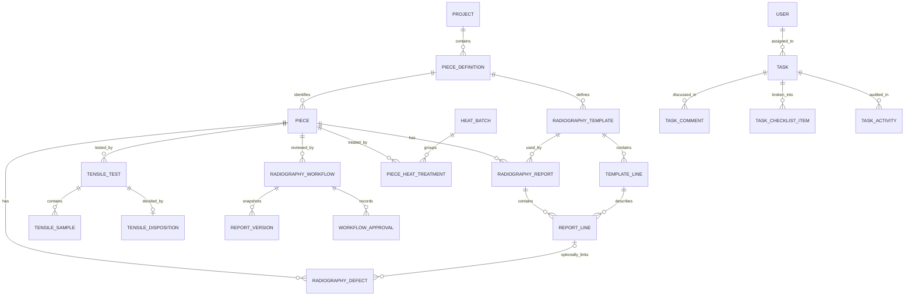

# Database structure

Integration 2026-11-02: approved categories 2–4 now combine with category 5; fixture totals are 52 tables / 66 FKs. See [Integrated release](INTEGRATED_RELEASE.md) for scope and upgrade requirements.

Update 2026-11-02: category 5 adds reasoned melt/welding cancellation, heat-batch archive/details, and previewed/audited shared-cycle corrections with separate permissions. See [Operational controls](OPERATIONAL_CONTROLS.md) for V41, compatibility and limits.

Update 2026-11-01 (items 2–1/2–2 only): normal progression uses independent ADVANCE_PIECE_STAGE; forward skips require MANAGER or an explicitly permitted ADMIN, a reason and an atomic audit. Other category-2 permission splits are deferred. See [Stage movement access](STAGE_MOVEMENT_ACCESS.md) for legacy-route guards, upgrade grants, V39 and validation limits.

Update 2026-11-02: category 4 adds audited note, welding mark, per-piece heat-treatment and material-catalog corrections; catalog writes require MANAGE_MELT_MATERIALS. V40 adds record_edit_events (50 tables, 65 FKs in synthetic fixture). See [CRUD editing](CRUD_EDITING.md) for contracts and upgrade limits.

Update 2026-11-01: category 1 introduces MANAGER (full access), explicit-grant ADMIN/OPERATOR, manager-only account management and access audit. Historical ADMIN-as-full-access descriptions below are superseded by [User access](USER_ACCESS.md). V38 and the sanitized fixture include the new audit table; runtime upgrade requires explicit initial-manager selection. Local Java/MySQL validation is blocked by missing Maven dependencies; see the linked implementation/upgrade notes.

Update 2026-10-31: V37 adds piece_scrap_dispatches and piece_scrap_dispatch_defects for reasoned, editable scrap cycles. The synthetic fixture is now 48 tables/65 FKs; the original 46-table/62-FK inspection remains historical. No legacy reasons are invented and the incomplete Flyway chain remains disabled for tests. See [scrap](SCRAP.md).

Update 2026-10-30 (Cloud preparation): [MySQL inventory](MYSQL_SCHEMA_INVENTORY.md) now records a read-only inspection of the local MySQL 8.0.31 schema (46 InnoDB tables, 62 FKs). The only Flyway history row is BASELINE 22. The older source-derived review below remains historical; no source schema was changed. A reviewed record-free schema fixture and isolated MySQL validation/CI are described in [Cloud testing](CLOUD_TESTING.md).

Update 2026-10-30 (assignment conflict): task_type may still be a legacy native MySQL ENUM or carry a Hibernate-generated enum CHECK despite the VARCHAR declaration. These can reject new melt task codes with error 1265/3819, surfaced as a generic 409. TaskTypeSchemaRepair and V36 reconcile those restrictions conditionally, without rewriting rows or permissions; current/mixed/business CHECKs are preserved. Both cases were reproduced on disposable MySQL 8.0.31. The deployed schema was not inspected. See [melt passports](MELT_PASSPORTS.md).

Update 2026-10-30: V35/JPA add nullable melt_passports.assigned_operator_id BINARY(16) and assigned_operator_name VARCHAR(255). Existing task_type VARCHAR(48)/workflow_id store MELT_PASSPORT_ENTRY and MELT_PASSPORT_APPROVAL references; no new permission codes or startup backfill. Historical rows stay unassigned. V35 is conditional/repeatable by inspection; MySQL execution and production deployment remain unverified. See [melt passports](MELT_PASSPORTS.md).

Update 2026-10-29 (V34): radiography_defects.start_cm/end_cm/location_cm widen from integer to nullable VARCHAR(255); radiography_defect_positions.start_cm/end_cm widen to non-null VARCHAR(255). JPA String fields match those lengths/nullability. V34__radiography_text_positions.sql repeats safely on the existing JPA-managed chain schema and preserves numeric values as text. It does not complete the older bootstrap chain. LegacyDefectChainRepair continues copying first locations using COALESCE; a standalone synthetic MySQL regression verified repeated migration/repair, numeric zero/range/null fallback preservation, L4-L7 and Persian labels, and all five column definitions. No startup repair was changed or added. Production migration execution, automatic Hibernate/Flyway upgrade behavior and deployment remain unverified.

Update 2026-10-29: RadiographyDefect adds nullable Boolean reshootOk mapped to radiography_defects.reshoot_ok. Null means no reshoot result for legacy rows; no backfill or deletion is required. V33__radiography_reshoot_ok.sql adds BIT NULL only when absent, allowing a manual upgrade before/after Hibernate update. The service enforces exclusivity with parent_defect_id children; the database has no cross-row check for it. LegacyDefectChainRepair does not read or overwrite this field, and no new startup repair is added. Existing chain fields/tables still depend on the reconciled JPA-managed schema; V33 does not repair the older incomplete migration chain. MySQL execution and production schema/deployment remain unverified.

Update 2026-10-26: V32 and MeltPassportEvent add nullable old_values/new_values MEDIUMTEXT JSON snapshots for ADMIN_CORRECTED events. Legacy events remain unchanged/null. Snapshots contain normalized business values, copied material labels and derived magnesium data; no nested events or generated child IDs. Decimal scale alone does not constitute a change. No new permissions, startup repair or production-data backfill is added. The standalone migration was tested repeatedly on isolated MySQL 8.0.31; this does not validate the older bootstrap chain or production deployment. See [melt passports](MELT_PASSPORTS.md).

Update 2026-10-24: V31 and matching JPA add performance_periods (user FK, aggregate version/revision, unique nullable open_user_key), performance_criteria (per-period decimal scores/weight, logical deletion) and performance_events (before/after JSON snapshots, copied actor identity and efficiencies). User/period FKs restrict deletion; actors are independent scalar copies. No permission changes or backfill/startup repair is required. See [employee performance](EMPLOYEE_PERFORMANCE.md). Automatic migration execution and production schema remain unverified.

Update 2026-10-19: [melt passports](MELT_PASSPORTS.md) add six JPA tables and matching MySQL DDL in V29, plus `pieces.version BIGINT NOT NULL DEFAULT 0`. The unique nullable active-piece key protects current membership; historical memberships and material snapshots remain. No schema SQL was run against production; V29 execution is not assumed from Flyway settings.

Reviewed: 2026-10-16. This is a source-derived schema reference, **not a production database inventory**. No database connection or production rows were used.

## Sources and schema ownership

Primary sources: [JPA entity package](../../src/main/java/com/factory/productmanager/model/entity), [SQL migrations](../../src/main/resources/db/migration), and [startup configuration/repairs](../../src/main/java/com/factory/productmanager/config).

Confirmed configuration enables Flyway properties (baseline-on-migrate at version 1) **and** Hibernate `ddl-auto=update`. However, the POM includes Flyway core/MySQL libraries without the Boot Flyway starter/integration module; the successful test classpath contains no `spring-boot-flyway` module, and no custom Flyway bean/call was found. `LegacyTemplateLineRepair` and V24/V26 comments explicitly describe Hibernate as the actual schema creator.

**Inference:** automatic Flyway execution is likely absent in this build despite the properties. It was not verified by starting against MySQL; tests explicitly disable Flyway. Never infer that all V1-V28 scripts have run, and do not simply enable a migration integration dependency as a routine upgrade.

The SQL sequence is not a complete current bootstrap: V26 alters/references `tasks`, but no earlier script creates it. The task/collaboration tables and newer defect-chain fields/positions rely on entity schema updates rather than a complete SQL history. `app_markers` is created by `TaskSchemaRepair`, not an entity. Hibernate updates also do not prove that SQL-only backfills, indexes, conversions, or deletions happened.

## Mapping conventions

- Entity primary keys are Java UUIDs generated through JPA. MySQL SQL scripts represent them as `BINARY(16)`. UUIDs appear as strings in JSON.
- Tables/columns use snake case. SQL files generally use InnoDB; deployed engine, collation, SQL mode, charset and server version remain unknown.
- Dates use `LocalDate` / SQL `DATE`; timestamps use `LocalDateTime` / SQL `DATETIME(6)` in scripts, with no stored timezone offset.
- Numeric tensile minima/results use `BigDecimal`, generally `DECIMAL(10,2)`. Furnace temperature is `DECIMAL(7,2)`, duration `DECIMAL(6,2)`.
- Enums are string-backed; selected entities explicitly force VARCHAR to avoid legacy MySQL ENUM behavior. Radiography substage has a compatibility converter.
- Associations are generally lazy. Many audit values are copied names/UUIDs rather than foreign-key relationships. No entity declares `@Version`.

## Relationship map

This diagram summarizes main associations; the table inventory below includes history, notifications, joins and optional references.

## Table inventory

Fields below highlight business columns and relationships; all 31 entity tables have `id` UUID keys. This is not a substitute for generated DDL or a complete column-by-column database dump.

### Identity and catalog

| Table / entity | Principal fields and constraints |
|---|---|
| `users` / `User` | Unique `username`; BCrypt password hash, full name, role, department, disabled flag, last activity, signature path/type/update time, creation time. No credential values are documented |
| `user_permissions` / element collection | `user_id` FK, permission code. User mapping loads permissions eagerly. No entity ID; SQL baseline has a user index |
| `projects` / `Project` | Unique code, name, creation time; one-to-many definitions |
| `piece_definitions` / `PieceDefinition` | Required project FK, row number, piece name, drawing path, minima `min_uts/min_ys/min_el/min_hb`; unique `(project_id,row_num)` |
| `pieces` / `Piece` | Required definition FK, piece number, current stage, three retained substage fields, current process date, archived-at/by, description, creation time; unique `(piece_definition_id,piece_number)` |

### Production history and repair

| Table / entity | Principal fields and relationships |
|---|---|
| `piece_stage_history` / `PieceStageHistory` | Required piece FK, entered stage, changed-at, display-name actor |
| `piece_sub_stage_history` / `PieceSubStageHistory` | Required piece FK, kind, substage string, changed-at, actor |
| `piece_stage_process_dates` / `PieceStageProcessDate` | Required piece FK, stage, process date; unique `(piece_id,stage)` |
| `piece_sub_stage_process_dates` / `PieceSubStageProcessDate` | Required piece FK, kind, substage, process date; unique `(piece_id,kind,sub_stage)` |
| `piece_welding_dispatches` / `PieceWeldingDispatch` | Required piece FK, defect type/custom text, notes, sent/completed times and actors, origin stage and each origin substage |
| `piece_welding_dispatch_defects` / many-to-many join | Dispatch FK and defect FK; SQL primary key `(dispatch_id,defect_id)` |
| `piece_notes` / `PieceNote` | Piece FK, content, creation time, copied author display name and username |
| `welding_map_marks` / `WeldingMapMark` | Piece FK, x/y percentage coordinates, defect type, note, creation time/actor; drawing comes from the piece definition |

History records describe transition events. Process-date tables hold one mutable date for each piece/stage or piece/kind/substage, **not one date per visit**. A rework loop can overwrite a previous visit's process date.

### Radiography

| Table / entity | Principal fields and constraints |
|---|---|
| `radiography_report_templates` / `RadiographyReportTemplate` | Definition FK, name, creation actor/time; unique `(piece_definition_id,name)` |
| `radiography_report_template_lines` / `RadiographyReportTemplateLine` | Template FK, sort order, course code, image count as string, IQI ABS, acceptance criteria, TH; unique `(template_id,course_code)` under legacy constraint name `uk_rg_template_line_no` |
| `radiography_reports` / `RadiographyReport` | Piece/template FKs, report date/number, request number, copied part/project names, reference standard, string status, created/updated actor/time; unique `(piece_id,template_id)` |
| `radiography_report_lines` / `RadiographyReportLine` | Report/template-line FKs, IQI real, result; unique `(report_id,template_line_id)` |
| `radiography_defects` / `RadiographyDefect` | Piece FK, optional report-line FK, course, type/custom type, Java `defectClass` stored as `type_code`, legacy location/start/end, welded/confirmed flags, corrective action, optional unique parent-defect FK, description, status, actor/time |
| `radiography_defect_positions` / ordered element collection | Defect FK, position order, start/end centimeters; multiple positions per root defect |
| `radiography_workflows` / `RadiographyWorkflow` | Piece/interpreter/assigner FKs, optional interpreter/manager-task FKs, status, round, rejection info, timestamps and nullable unique `open_key` |
| `radiography_workflow_approvals` / `RadiographyWorkflowApproval` | Workflow FK; copied piece ID, version ID, approver ID/name/username/role, approval type/decision/round/time/reason and independent signature-file reference |
| `radiography_report_versions` / `RadiographyReportVersion` | Workflow FK, copied piece ID, version number/kind, JSON text snapshot (`MEDIUMTEXT`), SHA-256 hash, actor/time; unique `(piece_id,version_no)` |
| `radiography_workflow_events` / `RadiographyWorkflowEvent` | Workflow FK, copied piece/actor IDs, action, actor name, old/new values, reason/time |

`open_key` equals the piece UUID string while a workflow is open; closure sets it to null. Its unique constraint allows historical closed workflows but at most one open workflow per piece. Approval `reportVersionId`, copied user/piece IDs, event actor IDs, and `Task.workflowId` are scalar fields, not all JPA FK associations.

Defect `parent_defect_id` represents one optional second defect, not an arbitrary child tree in service logic. Positions are an embeddable collection. Legacy location columns coexist with the newer position-chain model for compatibility.

### Tensile and heat treatment

| Table / entity | Principal fields and constraints |
|---|---|
| `tensile_tests` / `TensileTest` | Piece FK, test index, status, below-threshold flag/failure list, creation and review metadata; unique `(piece_id,test_index)` |
| `tensile_test_samples` / `TensileTestSample` | Test FK, sample index/label, UTS/YS/EL/HB, description, creation time; unique `(tensile_test_id,sample_index)` |
| `tensile_test_dispositions` / `TensileTestDisposition` | Unique test FK, disposition date, quantity, duration, temperature, next stage, inspection result, optional responsible-user FK, system-generated flag, notes/metadata |
| `heat_treatment_batches` / `HeatTreatmentBatch` | Unique batch code, treatment date, temperature, duration, furnace size, notes/metadata |
| `piece_heat_treatments` / `PieceHeatTreatment` | Piece/batch FKs, optional tensile-disposition FK, per-piece treatment-stage string, plate label/HB, details/metadata; unique `(batch_id,piece_id)` |

Heat-treatment log `treatment_stage` is free text distinct from enum `Piece.heatTreatmentSubStage`. One batch can contain pieces with different treatment-stage labels. No furnace/equipment master entity was found.

### Tasks and notifications

| Table / entity | Principal fields and relationships |
|---|---|
| `tasks` / `Task` | Title/description, status/priority, required creator/assignee user FKs, deadline/completed times, optional project/piece (`part_id`) FKs, task type and scalar workflow UUID, timestamps |
| `task_comments` / `TaskComment` | Required task/author FKs, content, created/updated times |
| `task_checklist_items` / `TaskChecklistItem` | Task FK, title, completed flag/user/time, sort order, creation time |
| `task_activities` / `TaskActivity` | Required task/actor FKs, action, old/new values, note, creation time |
| `system_notifications` / `SystemNotification` | Type/message, optional piece/test/recipient/task FKs, copied piece/project display fields, dedupe key/time; tensile-test reference is unique |
| `system_notification_reads` / `SystemNotificationRead` | Notification/user FKs, read time, dismissed flag; unique `(notification_id,user_id)` |
| `app_markers` / JDBC only | String primary key `name`, applied timestamp; records one-time permission migration marker |

Broadcast notification `recipient_id` is null; task notifications identify a recipient. Read/dismiss state belongs to the user, not the shared event. The `(recipient_id,dedupe_key)` notification index is **not unique**.

## Deletion and retention

- Project-to-definition and definition-to-piece mappings cascade all operations with orphan removal. Piece cascades include histories, defects, notes, marks, tensile tests and dispatches. Tests cascade samples/disposition; reports/templates cascade their lines.
- Piece API deletion is soft archive; project/definition deletion is a hard repository delete. Archiving does not remove records and does not free the piece-number unique constraint.
- Cross-module task/report/heat references are not all represented in those parent collections. Hard deletion can fail on remaining foreign keys; cascade behavior cannot be assumed from the project hierarchy alone.
- Workflow approval/version/event entities use workflow deletion cascade annotations; immutable through application APIs does not mean permanent under parent deletion or direct database access.
- SQL scripts and entity annotations can differ in delete actions. For example, migration-defined notification/test/heat links use cascade/set-null in selected places. Verify actual FK definitions on the isolated target schema before designing retention changes.
- Files are outside FK/cascade control. Back up drawing/signature storage together with database records; database-only restore is insufficient.

## Migration and startup-repair ledger

| Versions / mechanism | Source-defined purpose |
|---|---|
| V1 | Legacy baseline, including now-obsolete assignment fields/history |
| V2-V3 | Normalized tensile tests/samples/dispositions, minima, removal of old assignment data structures, system-generated decisions |
| V4-V7 | Furnace batches and piece logs; cycle/plate fields; treatment stage moved from batch to piece log |
| V8 | Rough-machining substage |
| V9-V10 | Radiography templates/reports/lines, defect link; form/column alignment |
| V11-V13 | Welding dispatches, legacy state remap, process dates/archive, custom defect types, dispatch-defect join |
| V14-V16 | ENUM-to-VARCHAR compatibility and nullable dispatch notes |
| V17-V18 | Notifications, per-user reads and dismissal |
| V19-V20 | Controlled-flow origin fields and legacy radiography remapping, including moves into heat treatment |
| V21, V23 | Radiography form/template-column repair; V23 handles leftover legacy `line_no` |
| V22 | Tensile sample description |
| V24-V26 | User profile, substage dates, radiography workflow/version/approval/event structures, signature/task extension columns |
| V27-V28 | Stage-history composite/date indexes; tensile-test creation-time index |
| `LegacyMysqlEnumRepair` | Startup enum/nullability conversions and legacy radiography remapping |
| `LegacyTemplateLineRepair` | Startup legacy template-column/index repair |
| `LegacyDefectChainRepair` | Startup welded-flag and root-position backfill |
| `TaskSchemaRepair` | Startup permission/notification conversions, marker table and one-time RECEIVE_TASKS grant |
| `DataSeeder` | Bootstrap administrator and operator-permission mutation at startup |

Some scripts are conditional/idempotent; others unconditionally add/drop columns or tables. V2 drops legacy assignment structures, and V19/V20 change business state. Treat replay as a data migration with real consequences, never as a harmless schema refresh.

## Indexes and validation gaps

Entity indexes cover task assignee/creator/status/priority/deadline/project/piece and common composite deadline filters; collaboration task/time/author lookups; workflow piece/interpreter/status; version/workflow and event/workflow/time; notification recipient/time/task/dedupe. SQL adds further history/test-date indexes. Their presence in production is unverified, particularly SQL-only V27/V28 indexes.

Future validation should use a disposable MySQL database with synthetic data to check empty bootstrap, upgrade from a representative schema, constraints/delete actions, indexes, MySQL collation/enum differences, and startup repair idempotency. Current H2 tests disable Flyway and do not validate this path. No database changes were made in this review.
