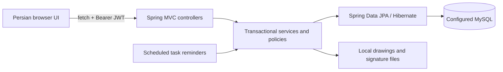

# Project overview

Update 2026-10-30 (Cloud preparation): runtime datasource/JWT literals were externalized and the default bootstrap password was removed. The prior user-requested inline-key configuration described below is historical and superseded by this task. A real read-only local MySQL inspection/backup found 46 InnoDB tables and a single Flyway baseline at version 22. Reviewed record-free structural fixtures, isolated MySQL tests, Cloud setup and GitHub Actions are documented in [Cloud testing](CLOUD_TESTING.md) and [inspected schema inventory](MYSQL_SCHEMA_INVENTORY.md). No source database DDL/DML or runtime application startup was performed.

Updated 2026-10-30 at the user's request: the JWT signing key is again stored directly in application.properties under app.jwt.secret. A new random key was generated; JWT_SECRET is no longer required, and scripts/Set-JwtSecret.ps1 was removed. Preserve the configured key between builds/restarts. Audit #2's external-key remediation has therefore been reverted; the key is included in source and the packaged JAR. Audit fixes **#1, #3, #5 and #6** remain: catalog edit XSS, UUID/password-bound token invalidation, permission regranting on startup, and authorization for piece-description changes. No database migration is required; changing the key requires users to log in again. Prior validation: 253 Maven tests, 236 passed/17 optional MySQL skipped, no failures/errors; 21 Node regressions; all 34 application scripts passed syntax checks; three enabled Chrome suites passed on isolated H2/upload storage. See [implementation, scope and launch notes](../audits/2026-10-30-security-fixes-fa.md). The default-datasource application was not started or deployed for this configuration change.

Security/CRUD audit 2026-10-30: [Persian report](../audits/2026-10-30-audit-fa.md) and [HTTP route coverage](../audits/2026-10-30-api-coverage.md). The explicitly authorized local test MySQL/application were exercised with synthetic fixtures; all 172 declared controller routes received a successful response in at least one scenario. Confirmed risks include stored XSS, active checked-in signing/bootstrap credentials in the local deployment, incomplete token revocation, workflow/integrity bypasses and file/transaction data loss. The audit changed tests/tools/documentation only, cleaned its fixtures, and did not inspect the separate production deployment. See the report for findings, validation totals and limits; route coverage is not a complete security guarantee.

Update 2026-10-30 (assignment compatibility): TaskTypeSchemaRepair/V36 handle old MySQL task-type ENUM/CHECK restrictions that reject the new melt entry/review codes and surface a generic conflict even on a fresh passport. The upgrade condition was reproduced on isolated MySQL; deployed schema/execution remains unverified. See [melt passports](MELT_PASSPORTS.md).

Update 2026-10-30: melt passports now support ADMIN operator assignment, operator entry tasks and shared review tasks visible to ADMIN/current melt approvers. Returns reopen the entry task; approval advances every current member, including a piece added by the operator without a separate assignment. Generic task routes cannot complete the workflow. V35 adds nullable assignment identity/name columns; execution/deployment is unverified. See [melt passports](MELT_PASSPORTS.md).

Update 2026-10-29 (follow-up): defect positions are now text points/ranges, e.g. (L4)(L5-L8), retaining the legacy API/column names and numeric JSON input compatibility. When welding and reshoot are both selected, chains render defect → reshoot → welding → OK (existing corrective actions keep their intervening position). V34 widens five position columns to VARCHAR(255) without deleting values. The standalone migration/startup-repair regression passed on synthetic MySQL; production execution/deployment remains unverified.

Update 2026-10-29: radiography, welding/map and dashboard defect selectors now share the requested 13 standard types plus OTHER/custom text. Report chains support an optional reshoot-OK result instead of a second defect, without changing course results or piece movement. The nullable reshoot_ok column and additive V33 script preserve existing records; production migration/deployment is not assumed. See [business workflows](BUSINESS_WORKFLOWS.md).

Update 2026-10-26: [melt passports](MELT_PASSPORTS.md) now support a separate ADMIN-only correction of approved business data with immutable piece membership, optional reason and before/after audit. Approval identity/time and piece movement/process dates remain unchanged, including old casting cycles. Calculator fields now follow the formula's LTR order. V32 adds nullable audit snapshot columns; production deployment is not assumed.

Update 2026-10-24: [employee performance evaluations](EMPLOYEE_PERFORMANCE.md) add independent weighted profile criteria, private owner/ADMIN visibility, per-user manual periods, full-score copies, audited closed-period corrections and concurrency controls. Task statistics and permissions are unchanged. V31 is additive; production migration/deployment is not assumed.

Reviewed: 2026-10-16. Scope: the local ProductManager source tree. This review changed documentation only.

## Evidence and limits

- **Confirmed** means observed in source, configuration, dependency metadata, or the test run described below. An implemented feature is not proof that it is enabled or used in production.
- **Inference / risk** means a consequence of the observed code that still needs a focused reproduction, deployment inspection, or business decision.
- No production database was connected to, queried, or exported. Database descriptions reconstruct the model from JPA mappings and SQL files; deployed schema, data, migration history, server version, and configuration overrides are unverified.
- `git status` reports that this directory is not a Git repository. There is no commit identifier for this snapshot. Source hashes were captured before documentation work for a final unchanged-source check.
- No pre-existing `AGENTS.md` was found in this project or its ancestor directories. `deploy/` is present but contains no files. `uploads/` contents were not examined.

## System shape

ProductManager tracks individual cast pieces for projects, production movement, inspection, repair, heat treatment, tensile testing, and work assignments. The browser interface is Persian and right-to-left.

It is one Maven Spring Boot application, with a same-origin static HTML/CSS/JavaScript interface and REST APIs. There is no separate frontend package/build, React/Angular/Vue application, message broker, or independently deployable service evidenced in the source.

## Repository map

| Location | Responsibility |
|---|---|
| `pom.xml`, `mvnw`, `mvnw.cmd`, `.mvn/wrapper/` | Maven build and wrapper |
| `src/main/java/com/factory/productmanager/ProductManagerApplication.java` | Application entry point |
| `controller/`, `service/`, `repository/` under the Java package | HTTP contracts, business operations, persistence |
| `model/entity/`, `model/dto/` | JPA entities, enums, validated requests and API responses |
| `security/`, `exception/`, `config/` | JWT/security, error responses, scheduling, startup compatibility repairs |
| `src/main/resources/application.properties` | Default configuration; contains sensitive settings, values omitted here |
| `src/main/resources/db/migration/` | 28 numbered SQL files, V1 through V28; execution is not established by their presence |
| `src/main/resources/static/index.html`, `js/`, `css/`, `fonts/` | Entire browser application, including locally bundled Vazirmatn fonts |
| `src/test/` | Unit and H2 integration tests and isolated test configuration |
| `uploads/` | Runtime file storage, ignored by `.gitignore` |
| `target/` | Build/test outputs; not an architectural source of truth |
| `.idea/`, `*.iml` | IDE metadata |

## Frameworks and dependencies

The POM declares Spring Boot **4.1.0**, artifact version **0.0.9**, and Java compilation target **17**. The review's successful test run used JDK **25.0.3**, not JDK 17; runtime compatibility on JDK 17 was not separately verified.

| Component | Evidence |
|---|---|
| Spring MVC, embedded Tomcat | `spring-boot-starter-webmvc` |
| Spring Data JPA / Hibernate | `spring-boot-starter-data-jpa`; test classpath resolved Hibernate 7.4.1.Final |
| Spring Security, BCrypt, method security | Security starter; resolved Security 7.1.0 |
| Jakarta validation | Validation starter, request annotations and `@Valid` |
| JWT | JJWT API/implementation/Jackson modules pinned to 0.12.6 |
| MySQL | Runtime Connector/J; test classpath resolved 9.7.0; database server version unknown |
| Flyway libraries | Core + MySQL modules; resolved 12.4.0; Boot Flyway integration module absent from inspected test classpath |
| JSON | Application uses Jackson 3 `tools.jackson.databind`; Jackson 2 artifacts also appear transitively |
| Lombok | Getters/setters/constructors and configured annotation processing |
| Tests | JUnit Jupiter 6.0.3, Spring test starters, MockMvc, Spring Security test support, H2 2.4.240 |
| Browser | Native DOM, Fetch, Canvas, SVG, localStorage; no third-party frontend framework/build manifest found |

Resolved versions above describe this local test classpath, not an independently inspected production artifact. Maven wrapper configuration requests Maven 3.9.16.

## Feature verification

Update 2026-10-22: melt reports moved to Dashboard Reports with server-side dashboard permission checks; profiles now expose a compact melt icon/history view at every stage. Forms and feedback were refined. The candidate lookup's MySQL collation failure was reproduced and fixed on an independent synthetic MySQL 8.0.31. Validation: 158 ordinary Maven tests, one separately enabled MySQL regression, 11 Node regressions and expanded Chrome desktop/mobile smoke passed. V29 migration execution and production deployment remain unverified; no default/production datasource was explored.

Added 2026-10-19: **melt passports** now provide shared CASTING records, materials/independent magnesium calculation, approval permission, atomic member advancement and a central casting-departure gate. See [melt passports](MELT_PASSPORTS.md) for contracts, schema, validation and deployment limits. Piece and passport entities now use optimistic versioning; the older entity/concurrency observations below describe the pre-feature review.

Validation for that addition: **154 Maven tests passed**, plus six existing JavaScript regressions and synthetic Chrome desktop/mobile smoke. MySQL migration/deployment remains unverified; the historical review results below are retained with their original date.

| Capability | Finding and principal implementation |
|---|---|
| Projects and part definitions | Implemented: `ProjectService`, `PieceDefinitionService`; drawings and shared tensile minima |
| Individual pieces and tracking | Implemented: `PieceService`; single/bulk creation, filtered pagination, archive/restore, histories and dates |
| Production stages/substages | Implemented: `StageTransitionPolicy`; controlled normal movement and administrator correction |
| Radiography reports | Implemented: templates/courses, per-piece reports, results, defect chains, browser printing |
| Radiography assignment/approval | Implemented: assigned interpreter, manager review/rejection, signature copies, report versions, tasks, notifications |
| Mandatory approval for every radiography move | **Not enforced universally**: without an open workflow, ordinary interpretation-to-VT movement remains available |
| Welding | Implemented as a station with dispatch/return logic; `WELDING` still persists in `PieceStage` |
| Heat treatment | Implemented: substages plus a separate furnace-batch operation log and optional tensile-disposition link |
| Machining | Rough machining substages and `CNC_SAMPLE` tracking exist; no dedicated CNC execution, tooling, machine scheduling, or machining measurements module found |
| Tensile testing | Implemented: UTS, YS, EL, HB, multiple samples/tests, threshold flags, automatic approval, manual disposition and stage routing |
| Quality analytics | Implemented: quality-index scatter plot, UTS/YS/EL trends, operational dashboard, defect/stage/welding reports and CSV exports |
| General tasks | Implemented: assignment, priorities, deadlines, comments, checklists, audit activities, profiles/statistics, reminders |
| Broad ERP/MES functions | No separate inventory, purchasing, costing, alloy/heat chemistry, furnace telemetry, or equipment integration implementation found |

## Validation performed

Existing Maven tests ran offline on 2026-10-16: **115 tests, 0 failures, 0 errors, 0 skipped; BUILD SUCCESS**. H2 in MySQL mode uses schema create/drop, Flyway disabled, reminders disabled, and test uploads under `target/`. This does not validate MySQL migrations, real concurrent requests, browser behavior, or deployment configuration.

The Windows wrapper failed with `Cannot index into a null array`; a cached Maven 3.9.16 executable was used with the existing local repository. No wrapper/build changes were made. Test coverage is concentrated in tasks, radiography approvals, and tensile trends; see [development guidelines](DEVELOPMENT_GUIDELINES.md).

## Main risks and next steps

1. Establish schema ownership and a reproducible MySQL bootstrap/upgrade path. SQL migrations, Hibernate `ddl-auto=update`, and startup repairs currently overlap; V26 references a `tasks` table that earlier SQL files do not create.
2. Review radiography integrity: defect mutation bypasses the report workflow gate, its read checks are unlocked, and completed live reports can diverge from signed snapshots.
3. Review access lifecycle: startup seeding restores permissions; source-defined bootstrap credentials and sensitive default configuration need a deployment review without copying values.
4. Characterize tensile correction/disposition behavior before changing it; edits preserve prior approval and piece movement, and later disposition edits can move a piece again.
5. Add isolated MySQL and focused stage/tensile/storage regression coverage, then reduce service size and duplicate transition paths in small changes.

Details and evidence are in [backend architecture](BACKEND_ARCHITECTURE.md), [frontend architecture](FRONTEND_ARCHITECTURE.md), [database structure](DATABASE_STRUCTURE.md), and [business workflows](BUSINESS_WORKFLOWS.md).
